# About 크레딧 확인 및 변경 — 0.4.1

## 변경 전 확인

기존 0.4.0 소스의 `Sources/PhotoSelect/App.swift` 92행에는 `Made with love ♡`를 11pt/secondaryLabelColor로 만든 코드가 있었고, 93행에서 macOS 표준 About 패널의 `.credits` 옵션으로 전달했다. 단순 계획이나 문서에만 있었던 것이 아니다.

[변경 전 실제 소스](https://github.com/NEO-82/Mac-photoselecter/blob/8d2e9952b1e5dd2aaca7a3dfae317ed3ffb9124e/Sources/PhotoSelect/App.swift#L92)

## 이번 변경

앞선 변경 요청에 따라 `Made with Seoa ♡`로 바꿨다. 최신 확인 요청의 기존 love 문구는 위 소스에서 확인했으며, 이전 Seoa 변경 요청을 취소한 것으로 해석하지 않았다.

- `Sources/PhotoSelect/App.swift:92`: 새 문구, 기존과 같은 11pt 시스템 글꼴, `ProTheme.accent` 로즈 색상.
- `Sources/PhotoSelect/App.swift:93`: 해당 크레딧을 실제 `NSApp.orderFrontStandardAboutPanel`로 전달. 앱 이름은 기존 `AppBranding.displayName`을 사용.
- 다크 모드의 로즈는 `#D4A0AC`, 라이트 모드는 가독성을 위한 `#95586B`. About에만 표시하며 앱 이름과 아이콘은 변경하지 않았다.
- 수정 전 전체 Git 체크포인트: `/workspace/checkpoints/photoselect-before-about-seoa.bundle` (검증 완료).

## 실제 macOS UI 검증

[빌드 #22](https://github.com/NEO-82/Mac-photoselecter/actions/runs/43090606679), 소스 `7ae0613d2318b882ca55065c43f2bdd6b84a82c3`에서 XCTest **62개 모두 통과**.

추가한 `BrowserUITests.testAboutMenuShowsSeoaCreditsInRoseOnNativePanel`은 실제 앱 정보 메뉴 action을 실행한다. 열린 표준 About 창의 NSTextView/NSTextField에서 표시되는 attributed text를 찾아 새 문구/이전 문구 부재/11pt 글꼴/다크·라이트 로즈 색상과 가시 영역을 확인한다. 소스 문자열만 비교하거나 계획을 확인한 결과가 아니다.

아래는 실제 표준 About 패널의 네이티브 캡처다. XCTest 호스트에서 열었으므로 이 캡처의 아이콘/버전 정보는 설치 앱과 다를 수 있다. 크레딧은 설치 앱과 같은 `showAbout` 코드를 호출해 검증했다. 배포 앱의 기존 한국어 이름과 ICNS 포함은 패키징 단계에서 별도로 검증했다.

## 설치 파일

[PhotoSelect-0.4.1-arm64.dmg](https://github.com/NEO-82/Mac-photoselecter/raw/refs/heads/codex/macos-installer-download/downloads/PhotoSelect-0.4.1-arm64.dmg)

Intel macOS/Xcode 16.4에서 테스트한 뒤 arm64 전용 Release 앱을 빌드했다. 앱 ad-hoc 서명, DMG 무결성, 읽기 전용 마운트 후 앱 서명 검증 통과. 실제 다운로드 HTTP 200, 3,487,281바이트, SHA-256 `24a1255a68dd93b492f541cc3b0463439685411b6533d223a3b596f72694fbc9` 일치 확인. Apple Developer ID/Apple 공증은 없는 개인 테스트용이다.
