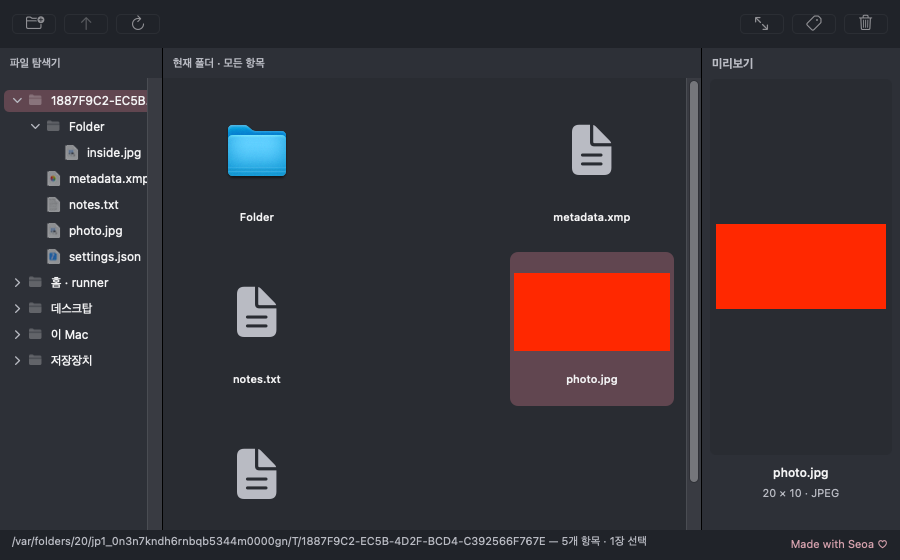
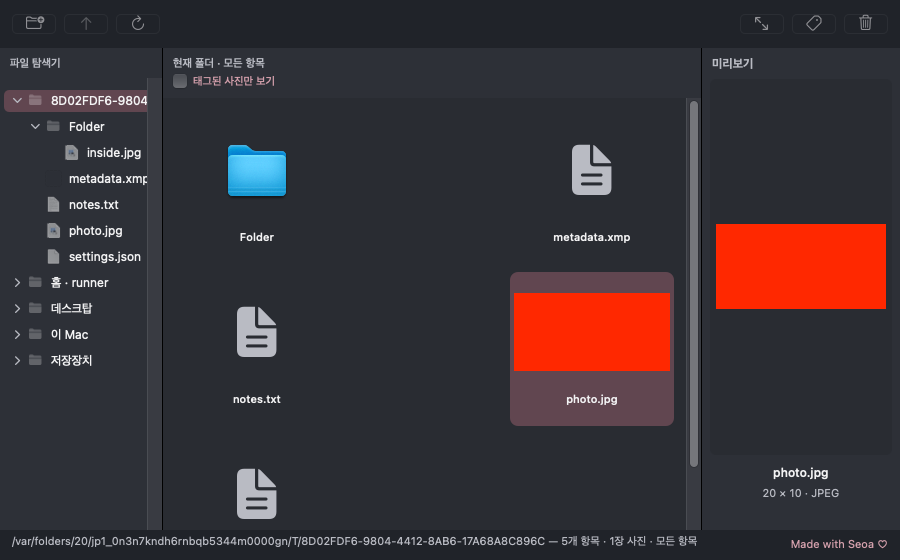
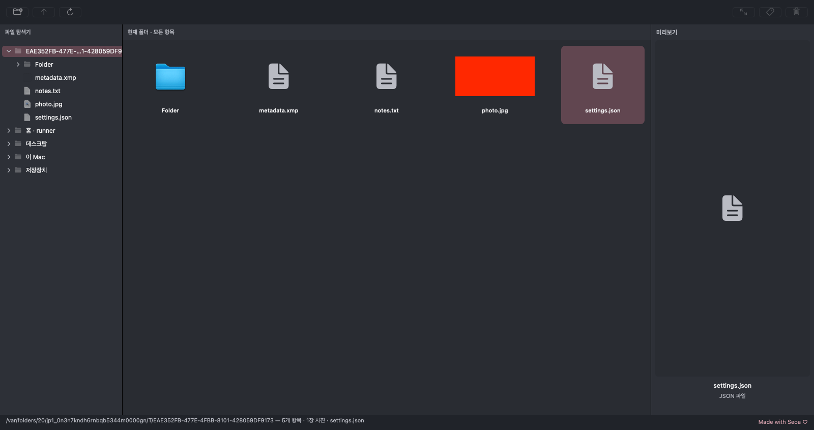

# Finder형 브라우저와 메인 창 크레딧 — 0.5.2

[Apple Silicon용 DMG 다운로드](https://github.com/NEO-82/Mac-photoselecter/raw/e08e654d8253176f71d68a2555024a4ac911c60c/downloads/PhotoSelect-0.5.2-arm64.dmg) · [macOS 빌드 #32](https://github.com/NEO-82/Mac-photoselecter/actions/runs/43230004616)

검증된 앱 소스 커밋은 `6a97b8e08b87221c93eed1650d2d5574f9218ecf`, 설치 파일·빌드 증거 커밋은 `e08e654d8253176f71d68a2555024a4ac911c60c`입니다.

## 변경 및 UI 확인

- 메인 창 하단 오른쪽에 11pt 로즈톤 `Made with Seoa ♡`를 고정 표시합니다. 상태 텍스트가 길어져도 크레딧 영역을 침범하지 않습니다.
- 가운데 그리드는 현재 폴더의 하위 폴더·이미지·일반 파일을 함께 표시합니다. 폴더가 먼저 정렬되며 폴더·일반 파일에는 아이콘과 이름을 표시합니다. XMP/TXT/JSON은 다크 배경에서도 보이는 문서 아이콘을 사용합니다.
- 폴더를 선택한 뒤 Return을 누르거나 더블클릭하면 진입하며, 상위 폴더 버튼으로 돌아옵니다. 일반 파일을 선택하면 오른쪽에 아이콘·파일명·확장자를 표시합니다.
- 사진 전용 뷰어 목록과 전체 항목 그리드를 분리했습니다. 사진 선택·뷰어 이동·태그·휴지통의 인덱스는 일반 파일이나 폴더가 섞여도 올바른 사진을 참조합니다.
- 창의 루트 콘텐츠를 `NSWindow.contentLayoutGuide`에 연결해 창을 줄인 뒤 다시 확대할 때 내부 콘텐츠도 함께 변경되게 했습니다. 크레딧은 고정 크기를 사용하며 테스트는 AppKit 텍스트 필드의 정렬 사각형으로 간격을 확인합니다.

아래 이미지는 최종 macOS 테스트에서 실제 AppKit 창을 캡처한 것입니다. 빨간 사각형은 테스트용 JPEG 이미지입니다.







## 검증 결과

| 검증 | 결과 |
| --- | --- |
| macOS XCTest | 86개 통과, 실패·오류·건너뜀 0 |
| 혼합 그리드 | 폴더·JPG·XMP·TXT·JSON 표시, 일반 파일의 이미지 디코딩 요청 없음 |
| 폴더 이동 | Return 키 이벤트와 등록된 더블클릭 핸들러 호출로 진입, 상위 폴더 복귀 확인 |
| 사진 미리보기 | 선택한 JPEG의 오른쪽 미리보기·그리드 썸네일 확인 |
| 창 크기 변경 | 실제 콘텐츠가 900×560 → 1200×760으로 변경됨을 확인, 크레딧 가시성·오른쪽 정렬·상태 텍스트 비겹침 검사 통과 |
| 실제 Sony 회귀 | A7M3/A7M4 내장 JPEG, Adobe RGB, 색 관리·고정 프리뷰·캐시 이동을 포함한 Release 3개 통과 |
| 앱 패키징 | arm64 Release 빌드, 표시 이름·공식 ICNS 10종·원본 픽셀 일치, ad-hoc 서명 검사 통과 |
| DMG | hdiutil 무결성 검사, 읽기 전용 마운트된 앱 서명과 Applications 링크 검사 통과 |
| 실제 다운로드 | HTTP 200, 3,790,026바이트, 저장된 SHA-256과 일치 |

테스트 결과는 [XCTest XML](../downloads/xctest-results.xml), [Release RAW XML](../downloads/release-preview-results.xml), [빌드 로그](../downloads/build.log), [아이콘 검증](../downloads/icon-validation.json), [다운로드 검증](../downloads/download-verification-0.5.2.json)에 저장했습니다.

```text
SHA-256: 98d00a6be0a4ffd91f477b5a91cb0bb69dc5e30b7e1e20146d43a24859d912b9
```

호스트는 Intel macOS/Xcode 16.4이며 배포 앱은 arm64입니다. 실제 Apple Silicon Mac 설치·Dock 표시, 물리 마우스의 더블클릭·드래그, SD/외장 저장장치의 접근·분리·휴지통은 별도 실기기 검증이 필요합니다. 자동 UI 검사의 더블클릭 확인은 등록된 제스처의 타깃/액션을 실행한 것이며 물리 입력 검사를 대신하지 않습니다. 숨김 항목은 기존 보기 메뉴로 켤 수 있고 심볼릭 링크는 기존 정책에 따라 제외합니다. 개인 테스트용 ad-hoc 서명이며 Apple Developer ID 서명과 Apple 공증은 포함하지 않습니다.

## 클라우드 빌드 접근 확인

실패했던 읽기 요청은 다음과 같습니다.

```text
GET https://api.github.com/repos/NEO-82/Mac-photoselecter/actions/workflows/package-macos.yml
```

기존 인증을 그대로 사용하는 `gh api --include repos/NEO-82/Mac-photoselecter/actions/workflows/package-macos.yml`은 `Get "https://api.github.com/repos/NEO-82/Mac-photoselecter/actions/workflows/package-macos.yml": Forbidden`을 반환했습니다.

동일 URL에 대한 HTTPS 연결 검사에서는 `curl: (56) CONNECT tunnel failed, response 403`을 확인했습니다. 프록시 응답은 `HTTP/1.1 403 Forbidden`, `server: envoy`였으며, GitHub API HTTP 요청은 전송되지 않아 curl의 API 응답 코드는 `000`이었습니다.

현재 환경 상태는 제한 네트워크 정책이 `enforced`이며, 허용 호스트에 `github.com`은 있고 `api.github.com`은 없습니다. 이 요청의 차단 원인은 GitHub 인증 실패가 아니라 API 호스트에 대한 네트워크 제한입니다. 요청이 GitHub에 도달하지 않았으므로 기존 토큰의 API 권한은 이 결과만으로 판단할 수 없습니다.

인증 토큰과 네트워크 허용 목록, 보안 설정은 변경하지 않았습니다. 기존 Git 인증으로 전달 브랜치 push가 성공했고 그 push로 실제 macOS Actions 빌드가 실행됐습니다. 결과는 Actions가 같은 브랜치에 저장한 로그·XCTest XML·화면 캡처·DMG를 Git으로 가져와 확인합니다. 최종 설치 파일은 공개 HTTPS 다운로드와 SHA-256 일치도 별도로 확인합니다.
