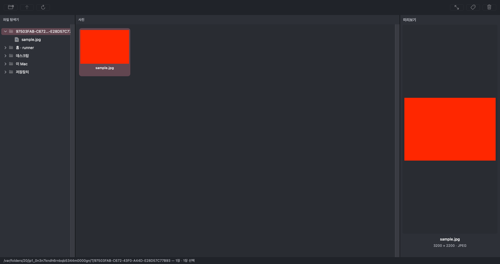
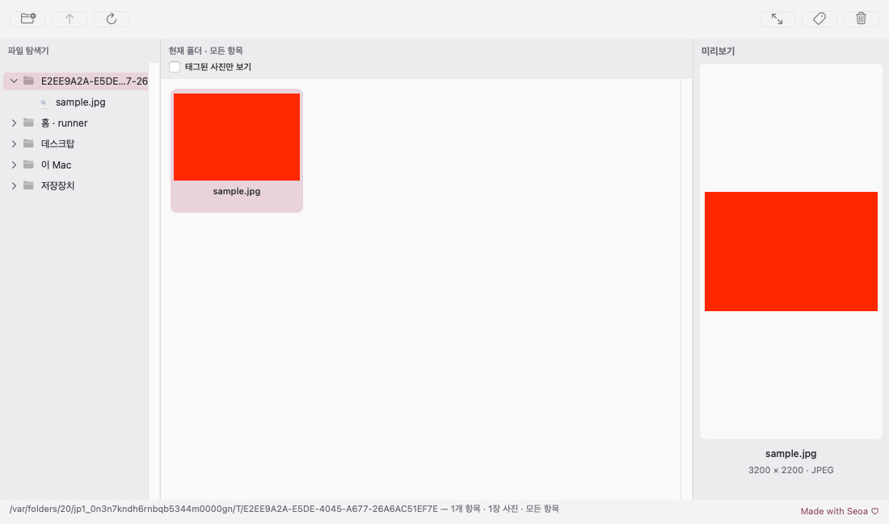

# 0.4.0 Soft Romantic Pro 개선 및 검증

수정 전 기준: `326ebb717d01ec351fb9a1012e4afe73ed57fb01`.
전체 이력 체크포인트: `/workspace/checkpoints/photoselect-before-0.4.bundle` (git bundle verify 통과).
현재 소스는 AppKit 3영역 UI, 비동기 FolderReader, ImageIO/CIRAWFilter 파이프라인, 용량 제한 캐시, 별도 JSON 태그를 사용한다. 이미지 디코더/캐시는 재작성하지 않았다. 기존 일괄 파일명 변경 구현은 이 체크아웃에 없으며 이번 작업에서 원본 이름 변경 기능을 추가하지 않았다.

## 구현

- **FolderTree.swift:** NSTableCellView 기반 네이티브 파일 트리, 명확한 펼침/접힘 SF chevron, 폴더 로즈 아이콘/선택 강조, 일반 파일 시스템 아이콘, 18pt 들여쓰기. 숨김 옵션과 갱신 시 펼친 경로/선택 복원. 폴더/파일 필터와 사진 디코딩 필터 분리. 알려진 빈 폴더는 펼침 버튼을 숨기고, 미조회 폴더는 지연 로딩으로 확인한다.
- **App.swift / Browser.swift:** 차콜/로즈 팔레트와 라이트 대응, 실시간 테마 변경 및 다음 실행 시 선택 보존. 폴더 동작과 사진 동작 툴바 그룹, 14pt SF Symbols, 툴팁/접근성 이름, 태그/삭제 상태 피드백. 사진/미리보기 배경과 정보 정돈. 경로·사진 수·선택 수가 있는 하단 상태줄과 전체 내용 툴팁. 앱 이름/아이콘과 About 크레딧 유지.
- **Browser.swift / PhotoModel.swift:** 사용자가 늘린 탐색기/미리보기 폭을 창 크기와 사진 변경 이후에도 유지. 작은 창에서는 사진 영역 최소 공간을 확보하도록 제한.
- **Viewer.swift / Browser.swift:** 빠른 더블클릭은 확대나 원본 요청 없이 닫는다. 마우스를 가만히 누른 확대는 macOS 더블클릭 판별 시간만큼 기다린 후 시작하며 드래그는 즉시 확대한다. 이는 첫 누름 확대가 더블클릭 전에 잠깐 보이는 현상을 막기 위한 조정이다. ESC·놓기·비활성화는 대기 중 확대를 취소한다. 큰 창 진입/복귀 때 동일 사진은 재디코딩하지 않고 기존 미리보기/썸네일/스크롤을 보존한다.
- **PhotoActions.swift:** FileManager.trashItem 및 OS 반환 이동 위치 사용. 읽기 전용/권한/미지원/파일·장치 없음 오류 구분. 성공 후에만 목록에서 제거. 외장 장치 휴지통의 공간 사용/복원 시 연결 필요 안내. 영구 삭제 fallback과 별도 영구 삭제 기능은 제공하지 않는다. UI는 기존처럼 한 장씩 처리하며 동명 RAW/JPG는 독립 파일이다.

## 검증 기록

Linux 패키징 제어 흐름 테스트 9개 및 git diff --check 통과. [macOS 빌드 #21](https://github.com/NEO-82/Mac-photoselecter/actions/runs/43038529075), 소스 `90ca5a72e1e3b70f37150105d7df0145aeb52bb0`에서 **XCTest 61개 모두 통과**했다. Intel macOS/Xcode 16.4의 테스트 결과이며 별도 arm64 Release 빌드, 앱 이름/아이콘·ad-hoc 서명·DMG 무결성·읽기 전용 마운트된 앱 서명 검증이 통과했다. Swift Testing의 별도 0개 표시는 XCTest 61개와 구분한다.

실제 다운로드 HTTP 200, 3,487,169바이트. SHA-256: `7d2b52dce15f1b0deaa37bac6ceb377aafcf32816b76258fbd1af90b6b42a010`. 업로드된 파일과 다운로드한 파일 모두 `downloads/SHA256SUMS`와 일치한다.

| 검증 항목 | 결과와 범위 |
| --- | --- |
| 일반 파일/사진 목록 분리 | 통과: 일반 파일 선택 시 사진 미리보기 유지 |
| 펼침/접힘과 숨김 옵션 | 통과: 네이티브 버튼 performClick, 빈 폴더, 경로·선택 보존 |
| 패널 폭 | 통과: AppKit 분할선 변경 후 창 크기/사진 변경에도 유지 |
| 뷰어 더블클릭/ESC/확대/방향키 | 통과: 생성한 NSEvent로 입력 핸들러/그리기 검사; 물리 입력은 미검증 |
| 뷰어 전환 | 통과: 동일 미리보기/썸네일 객체·스크롤 유지, 오류/장치 변경 안내 |
| 휴지통 이동/실패 시 보존 | 통과: 실제 macOS CI 테스트 파일 이동 후 반환 위치에서 복원; 실패별 원본 보존 |
| SD/USB/외장 SSD | 실기기 미검증; 아래 절차 필요 |
| 다크/라이트 디자인 | 통과: 네이티브 창 캡처·색상 검사 및 이미지 시각 검토 |
| 기존 사진/태그 | 기존 자동 회귀 통과; 실제 Sony RAW 디코딩과 호환성은 별도 |
| 일괄 이름 변경 | 이 체크아웃에 구현 없음; 기능 제거는 하지 않았고 검증 불가 |
| 1,500장 이상 | 파일 열거/필터 통과; 실제 RAW 썸네일·전환 속도/메모리는 미측정 |
| Apple Silicon 빌드 | arm64 단일 아키텍처 빌드 통과; 실제 M1 Pro 실행은 미검증 |

처음 실패한 검증은 소스/테스트를 진단한 뒤 재실행했다. 숨김 테스트의 `/var`와 `/private/var` 동일 경로는 정규화해 비교했고, 테마 색상은 ICC가 있는 PNG를 명시적 sRGB로 변환해 검사했다. 테스트 허용 오차/시간 제한을 늘리거나 실패 검사를 제거하지 않았다. 느린 갱신 중 사용자가 선택한 새 폴더가 이전 결과에 의해 되돌아가지 않는 경계 테스트도 추가했다.
추가 XCTest는 네이티브 펼침 버튼 performClick, 숨김 옵션과 경로 복원, 1,500장 혼합 폴더의 비동기 열거, 뷰어 이벤트/복귀 객체 보존, 테마 실제 픽셀, 오류별 원본 보존, 실제 macOS 휴지통 이동 후 테스트 파일 복원을 확인한다. 열거용 ARW는 빈 확장자 fixture이며 실제 RAW 디코딩/성능 검증이 아니다.

## 실기기 미검증 항목과 절차

- M1 Pro에서 DMG 앱 설치 후 실제 Sony ARW/JPG 1,500장 이상 폴더를 열어 전환/확대/스크롤과 메모리를 기존 버전과 비교한다. 실제 ARW는 소유한 샘플로 카메라 모델/압축 형식을 기록한다.
- 폴더 펼침 화살표와 이름을 각각 클릭하고 선택/펼침이 독립인지 확인한다. 패널 폭을 늘린 뒤 사진 변경·창 크기 변경·숨김 옵션·새로고침 후 위치를 확인한다.
- 빠른 더블클릭은 확대 없이 목록 복귀, 길게 누름/드래그는 확대, 놓기/ESC는 맞춤/복귀, 누른 채 방향키는 확대 유지인지 실제 마우스로 반복한다. 큰 창을 다시 열어 같은 사진과 그리드 스크롤을 확인한다.
- 원본이 아닌 테스트 복사본으로 내부 SSD, APFS 외장 SSD, exFAT SD/USB 각각 휴지통 이동/같은 장치 연결 상태의 Finder 휴지통 복원을 확인한다. 휴지통을 비우기 전 공간 사용은 정상일 수 있다. 쓰기 잠금·읽기 전용·휴지통 미지원 매체에서는 실패 안내와 원본 보존을 확인한다. 전체 휴지통을 비우는 자동 테스트는 하지 않는다.
- 다크/라이트/시스템 테마의 글자 대비와 Retina/보조 모니터에서 창/분할선을 확인한다.

실제 장치, 물리 입력 및 실제 Apple Silicon 실행을 CI의 Intel macOS 테스트나 arm64 크로스 빌드와 동일한 검증으로 취급하지 않는다. 앱은 개인 테스트용 ad-hoc 서명이며 Developer ID/Apple 공증은 별도이다.

## 실제 macOS 화면 캡처

아래 이미지는 테스트 JPEG를 표시한 실제 AppKit 창 캡처이며 디자인 시안이 아니다.

