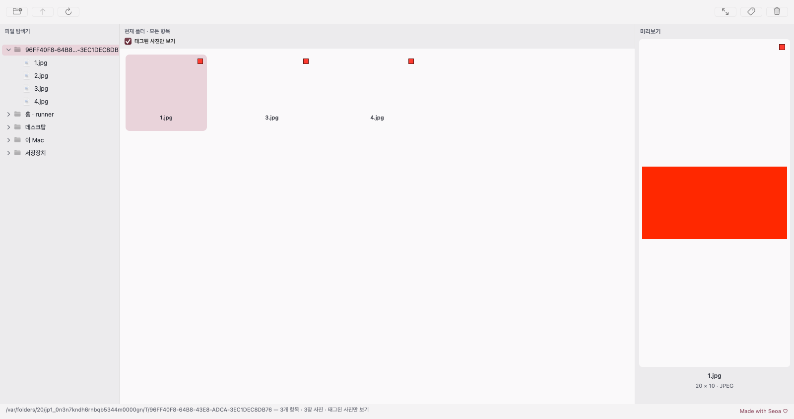

# 태그된 사진만 보기 (0.5.3)

현재 폴더 그리드 상단의 로즈 색 체크 버튼으로 태그된 사진만 표시합니다. 해제하면 폴더·일반 파일을 포함한 기존 목록으로 돌아갑니다. 필터는 이미 읽은 현재 폴더의 항목과 메모리의 태그 경로 집합만 사용하며 재정렬, 폴더 재탐색, 이미지 캐시 초기화, RAW 재디코딩을 수행하지 않습니다. 선택 사진이 남아 있으면 미리보기 객체와 진행 중 요청도 유지합니다.

큰 사진 창은 같은 필터 목록으로 좌우 탐색합니다. 태그 해제 시 다음 사진, 마지막이면 이전 사진을 선택하며 빈 목록이면 창을 닫습니다. Esc 복귀 후에도 체크 상태는 유지합니다. 휴지통 이동 성공 시 원래 폴더 스냅샷에서도 해당 파일을 제거하여 필터를 해제해도 되살아나지 않습니다. 태그/휴지통 처리가 비동기로 완료되기 전 다른 사진이나 폴더를 선택한 경우에도 현재 선택과 현재 폴더를 기준으로 목록을 갱신합니다.

`TagStore`, tags.json version 1, 태그 저장/종료 처리, Sony 내장 JPEG 디코더, 색 처리, 100% 확대, 단축키, 앱 아이콘은 변경하지 않았습니다. 필터 상태 자체는 저장하지 않으며 앱을 다시 실행하면 전체 목록 모드로 시작합니다. 기존 태그는 계속 복원합니다.

변경 파일:
- `Sources/PhotoSelect/Browser.swift`: 체크 버튼, 현재 폴더 스냅샷의 필터, 선택/뷰어/삭제 연동.
- `Tests/PhotoSelectTests/BrowserUITests.swift`: 필터 전환, 더블클릭, 방향키, 역슬래시/원화 태그, 마지막 태그 해제, Esc, 필터 중 휴지통, 원본 보존, 기존 JSON 복원, 1,500장 필터의 범위/순서/미리보기 재사용 검사.
- `.github/workflows/package-macos.yml`, `scripts/package-macos.sh`, `PhotoSelect.xcodeproj/project.pbxproj`: 설치 파일 버전 0.5.3.

물리 키보드/마우스 입력, Apple Silicon Mac 설치 후 실행, 실제 SD/외장 저장장치 휴지통·복구, 1,500장 실제 Sony 촬영 폴더 체감 성능은 실기기 확인이 필요합니다. 테스트의 휴지통 동작은 주입된 파일 이동기로 검증하며 macOS 실제 휴지통을 비우거나 사용자 사진을 조작하지 않습니다.

## 최종 검증과 설치 파일

[macOS 빌드 #40](https://github.com/NEO-82/Mac-photoselecter/actions/runs/43365236450)의 소스 커밋은 `4815ad658c7b25e7603b10ebb0d3e1a71b88cea4`입니다. Intel macOS/Xcode 16.4에서 XCTest **88개**, 최적화된 Release Sony ARW 검사 **3개**가 실패·오류·건너뜀 없이 통과했습니다. 새 필터 통합 테스트는 ON/OFF, 더블클릭, 좌우 키, 역슬래시/원화 키 태그 해제, 다음/이전 선택, Esc 유지, 필터 중 휴지통, 빈 목록 종료, 비동기 새 태그 반영 및 기존 JSON 복원을 검증합니다. 1,500장 JPG + 동명 RAW 테스트는 현재 폴더 범위, 정렬, RAW/JPG 독립성, 선택 미리보기 객체 재사용, JSON/원본 불변 및 필터 전환 **1초 미만**을 확인했습니다. 이는 CI의 작은 JPEG fixture 검사이며 실제 1,500장 Sony 촬영 폴더의 실기기 체감 속도 측정은 아닙니다.

arm64 전용 Release 앱, ad-hoc 서명, DMG 무결성, 읽기 전용 마운트 후 내부 앱 서명, 공식 아이콘 10종과 원본 일치 검증도 통과했습니다. Linux 패키징 제어 흐름 검사 9개, Bash 구문 및 diff 공백 검사도 통과했습니다. 앱 로직이나 실제 macOS 실행을 Linux 검사로 대체하지 않았습니다.

[0.5.3 빌드 40 DMG 다운로드](https://github.com/NEO-82/Mac-photoselecter/raw/80570b931c3c119882390d91f02d38f6b3f83506/downloads/PhotoSelect-0.5.3-arm64.dmg) · [SHA256SUMS](https://github.com/NEO-82/Mac-photoselecter/raw/80570b931c3c119882390d91f02d38f6b3f83506/downloads/SHA256SUMS)

실제 다운로드: HTTP **200**, **3,797,415바이트**. 체크섬:

```text
5186932b0b067f3b523c2c952546b9b879fdd295f945e6377c7b886c60c7e519  PhotoSelect-0.5.3-arm64.dmg
```

[다운로드 검증 JSON](../downloads/download-verification-0.5.3.json), [XCTest 결과](../downloads/xctest-results.xml), [Release 검사](../downloads/release-preview-results.xml), [빌드 로그](../downloads/build.log), [아이콘 검증](../downloads/icon-validation.json).



설치 파일은 개인 테스트용 ad-hoc 서명이며 Developer ID 서명/Apple 공증은 포함하지 않습니다. 실제 Apple Silicon Mac에 설치하여 실행한 결과로 안내하지 않습니다.
